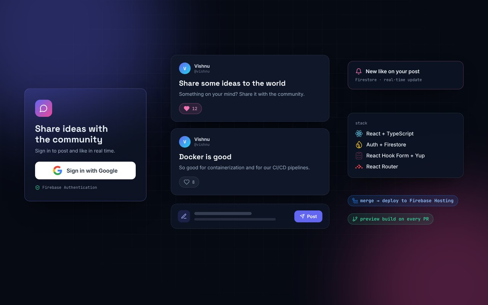

<div align="center">



# Social Media Web App

**A real-time social feed where people sign in with Google, share short posts and like each other's posts.**


</div>

---

## Features

- **Google sign-in and sign-out** with Firebase Authentication. The navbar changes with the user's login state and shows their name and photo.
- **Real-time post feed** stored in Cloud Firestore.
- **Likes**: each user can like or unlike a post once, and the like count updates instantly.
- **Create post** form with validation using **React Hook Form** and **Yup** (title required, description 3 to 150 characters).
- **Routing** with React Router: home feed, login and create-post pages.
- Written in **TypeScript** with small, reusable components.

## How it works

```
Browser (React + TypeScript)
   │
   ├── Firebase Auth ──── Google sign-in, session state (react-firebase-hooks)
   │
   └── Cloud Firestore
         ├── posts   { title, description, username, userId }
         └── likes   { postId, userId }
```

## CI/CD

Two GitHub Actions workflows deploy the app to **Firebase Hosting**:

| Workflow | Trigger | What it does |
| --- | --- | --- |
| `firebase-hosting-merge.yml` | push to this branch | builds and deploys to the live channel |
| `firebase-hosting-pull-request.yml` | pull request | builds a preview deployment and comments the preview URL on the PR |

## Project structure

```
src/
├── config/firebase.ts           # Firebase app, Auth (Google provider) and Firestore
├── components/navbar.tsx        # links, user name, avatar and logout
└── pages/
    ├── login.tsx                # Google sign-in
    ├── main/main.tsx            # fetches and lists posts
    ├── main/post.tsx            # single post with like / unlike
    └── create-post/             # form with React Hook Form + Yup
```

## Run locally

```bash
git clone -b Firebase-Social-Media-project https://github.com/vishi-vishnu/react-course.git
cd react-course
npm install
npm start          # http://localhost:3000
```

To use your own Firebase project, replace the config in `src/config/firebase.ts` and enable **Google** as a sign-in provider and **Cloud Firestore** in the Firebase console.

## What I learned

- Firebase Authentication with a Google provider and auth-aware UI
- Modelling posts and likes in Firestore and keeping the UI in sync
- Form validation with React Hook Form and Yup schemas
- Automating deploys and PR previews with GitHub Actions

---

<div align="center">

Built by **Vishnu Kumar G K** · [Portfolio](https://github.com/vishi-vishnu/portfolio) · [LinkedIn](https://www.linkedin.com/in/vishnu081/) · [GitHub](https://github.com/vishi-vishnu)

</div>
